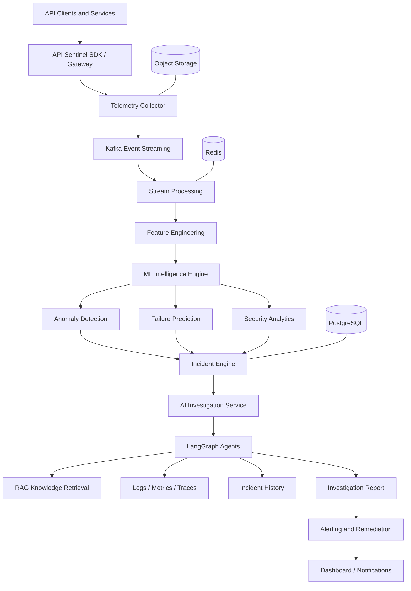
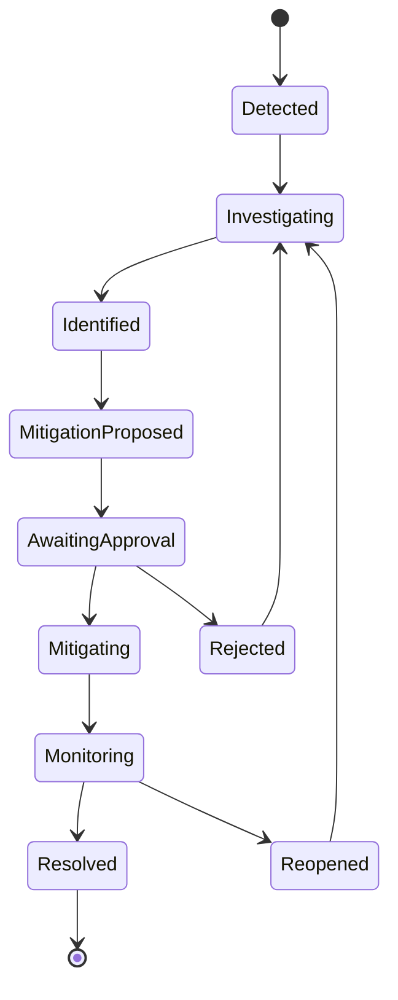
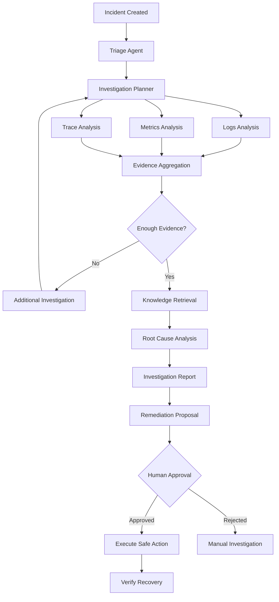
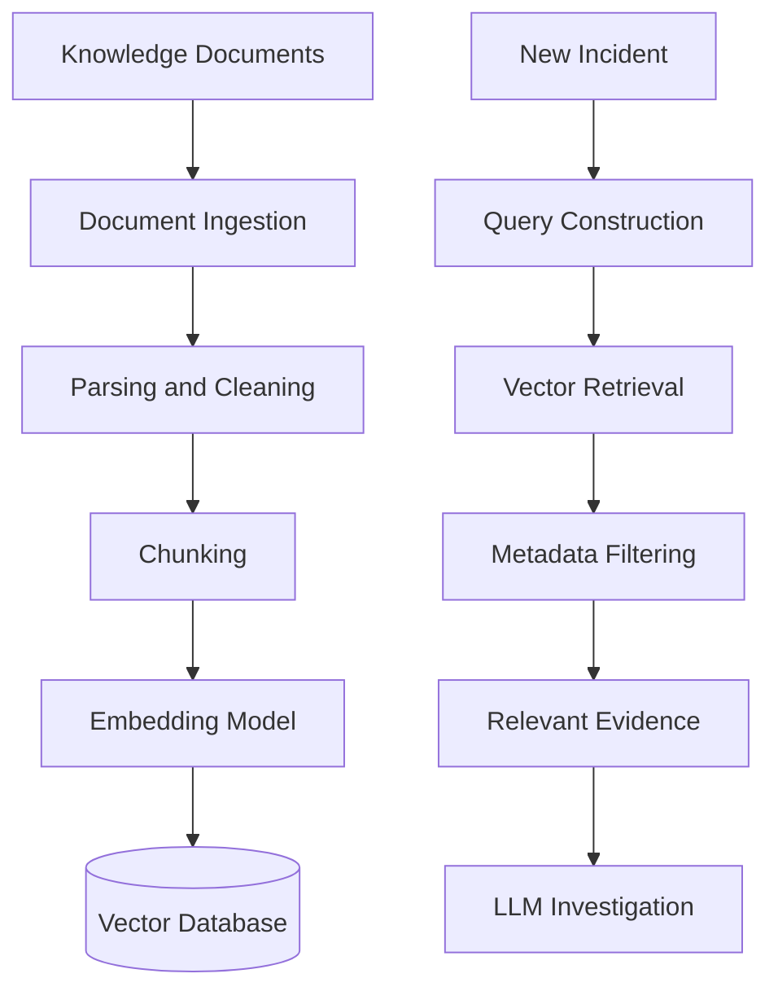
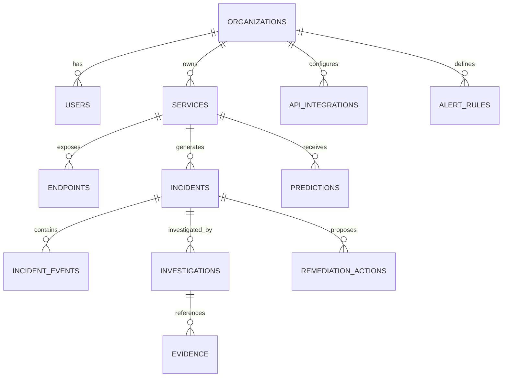
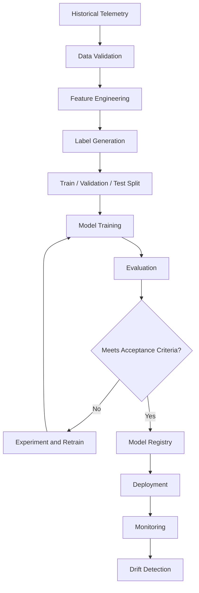

# API SENTINEL
## Enterprise API Observability, Predictive Intelligence & Agentic Incident Response Platform

**Document Type:** Product Requirements Document + Software Architecture Document + Technical Implementation Specification  
**Version:** 1.0  
**Status:** Proposed Architecture  
**Product Category:** Developer Tools / API Observability / AIOps / Cybersecurity  
**Architecture:** Distributed, Event-Driven, Multi-Tenant SaaS  
**Primary Backend:** Python + FastAPI  
**ML Framework:** Scikit-learn, XGBoost, PyTorch  
**Agent Framework:** LangGraph  
**Database:** PostgreSQL  
**Streaming:** Apache Kafka  
**Infrastructure:** Docker, Kubernetes  

---

# 1. Executive Summary

## 1.1 Introduction

API Sentinel is an AI-powered API observability and predictive intelligence platform designed to monitor, analyze, predict, investigate, and respond to API-related incidents.

Traditional API monitoring systems primarily rely on predefined thresholds, HTTP status codes, and static alerting mechanisms.

API Sentinel takes a different approach.

It combines:

- API observability.
- Machine learning-based anomaly detection.
- Predictive failure analysis.
- Traffic behavior analysis.
- Security monitoring.
- AI-powered incident investigation.
- Retrieval-Augmented Generation (RAG).
- Agentic incident response.
- Automated remediation with human approval.

The platform continuously collects API telemetry, establishes behavioral baselines, identifies deviations, calculates operational risk, and provides engineers with actionable explanations.

Instead of simply informing engineers that an API has failed, API Sentinel attempts to answer:

1. What happened?
2. Which services are affected?
3. When did the abnormal behavior begin?
4. What is the probable root cause?
5. What evidence supports this conclusion?
6. What is the potential impact?
7. What should the engineering team do?
8. Can the problem be safely resolved automatically?

## 1.2 Product Vision

Build an intelligent infrastructure monitoring system that moves organizations from reactive API monitoring to predictive and agent-assisted operations.

**Vision:** An intelligent operational layer that understands API behavior, anticipates failures, and helps engineering teams resolve incidents before they become major outages.

## 1.3 Core Product Capabilities

| Capability | Description |
|---|---|
| API Monitoring | Continuous monitoring of API health and performance |
| Anomaly Detection | Identify abnormal traffic, latency, and error behavior |
| Failure Prediction | Predict potential service degradation |
| Security Analytics | Detect suspicious API access patterns |
| Root Cause Analysis | Correlate metrics, logs, traces, and events |
| AI Investigation | Investigate incidents using LLM agents |
| Knowledge Retrieval | Retrieve relevant documentation and historical incidents |
| Intelligent Alerting | Prioritize incidents based on severity and risk |
| Automated Remediation | Execute approved recovery workflows |
| Observability Dashboard | Visualize the health of an entire API ecosystem |

---

# 2. Problem Statement

Modern applications consist of multiple interconnected services.

A single user request might travel through:

- API Gateway.
- Authentication service.
- User service.
- Payment service.
- Database.
- External third-party API.

A failure in one component can propagate through the entire system.

Traditional monitoring has several limitations.

### 2.1 Reactive monitoring

Most systems alert engineers after a threshold has already been crossed.

For example:

- API latency exceeds 2 seconds.
- Error rate exceeds 5%.
- CPU utilization exceeds 90%.

These thresholds cannot always distinguish normal traffic variations from genuine anomalies.

### 2.2 Lack of contextual intelligence

An alert such as `HTTP 500 spike detected` does not explain why it happened.

Engineers must manually inspect:

- Application logs.
- Database performance.
- Deployment history.
- Distributed traces.
- Infrastructure metrics.

### 2.3 Alert fatigue

Static monitoring can generate hundreds of alerts for a single underlying incident.

This makes prioritization difficult.

### 2.4 No predictive intelligence

Most basic monitoring systems identify current problems rather than estimating the likelihood of future failures.

### 2.5 Fragmented incident investigation

Historical incidents, documentation, infrastructure changes, and logs often exist in separate systems.

API Sentinel aims to connect these sources.

---

# 3. Product Scope

## 3.1 In Scope

The initial product will support:

1. REST API monitoring.
2. HTTP request and response telemetry.
3. Latency analysis.
4. Error-rate analysis.
5. Traffic anomaly detection.
6. Predictive failure scoring.
7. Incident creation and management.
8. Security anomaly detection.
9. AI-assisted incident investigation.
10. Historical incident retrieval.
11. Alert notifications.
12. Human-approved remediation.
13. Multi-tenant organization management.

## 3.2 Out of Scope for Initial Release

The following features should not be prioritized during the first implementation:

- Full application performance monitoring for every programming language.
- Automatic modification of production infrastructure.
- Complete SIEM replacement.
- Advanced endpoint penetration testing.
- Autonomous database migrations.
- Arbitrary code execution by AI agents.
- Universal support for every cloud provider.

These can be considered in later versions.

---

# 4. Target Users

| User | Primary Requirements |
|---|---|
| Backend Developer | Understand API failures and latency |
| DevOps Engineer | Monitor service health and infrastructure |
| SRE | Investigate incidents and reduce MTTR |
| Security Engineer | Identify suspicious API behavior |
| Engineering Manager | Monitor reliability and incident trends |
| CTO | Understand system reliability and operational risks |

---

# 5. High-Level System Architecture

API Sentinel follows an event-driven microservices architecture.

The system is divided into six major layers.

1. Data collection layer.
2. Streaming and processing layer.
3. Storage and observability layer.
4. Machine learning intelligence layer.
5. Agentic investigation layer.
6. User interaction and notification layer.

## 5.1 Architecture Diagram



## 5.2 Component Responsibilities

### Data Collection Layer

Responsible for receiving API telemetry from monitored applications.

### Streaming Layer

Responsible for asynchronous event transportation and buffering.

### Processing Layer

Responsible for cleaning, transforming, aggregating, and enriching telemetry.

### ML Intelligence Layer

Responsible for detecting anomalies and calculating operational risk.

### Agentic Investigation Layer

Responsible for investigating incidents, retrieving contextual information, and generating evidence-backed recommendations.

### Presentation Layer

Responsible for dashboards, alerts, incident timelines, and operational controls.

---

# 6. Detailed Technology Stack

## 6.1 Backend

**Python + FastAPI**

Responsibilities:

- REST API development.
- Authentication and authorization.
- Organization management.
- Incident management.
- ML inference endpoints.
- Agent orchestration endpoints.
- Telemetry ingestion APIs.

Supporting libraries:

- Pydantic.
- SQLAlchemy.
- Alembic.
- httpx.
- Uvicorn.
- Celery or an equivalent background-job system where appropriate.

## 6.2 Frontend

**React + TypeScript**

Responsibilities:

- Organization dashboard.
- API inventory.
- Service health visualization.
- Incident management.
- ML analytics.
- AI investigation reports.
- Alert configuration.
- User and team management.

Suggested libraries:

- React.
- TypeScript.
- Tailwind CSS.
- TanStack Query.
- Recharts.
- React Router.

## 6.3 Database

**PostgreSQL**

Stores:

- Users.
- Organizations.
- API integrations.
- Service metadata.
- Incidents.
- ML predictions.
- Investigation reports.
- Alert configurations.
- Audit records.

Time-series storage can initially use PostgreSQL partitioning. A specialized time-series database can be introduced when ingestion volume justifies it.

## 6.4 Cache and Queues

**Redis**

Responsibilities:

- Frequently accessed service metadata.
- Short-lived API state.
- Rate limiting.
- Distributed locks.
- Job coordination.
- Temporary aggregation state.

Redis should not become the permanent source of truth for incident records.

## 6.5 Streaming

**Apache Kafka**

Kafka transports telemetry and system events between independent services.

Suggested topics:

| Topic | Purpose |
|---|---|
| telemetry.raw | Raw API telemetry |
| telemetry.processed | Cleaned telemetry |
| metrics.aggregated | Aggregated metrics |
| anomalies.detected | ML anomaly events |
| predictions.generated | Failure predictions |
| incidents.created | New incidents |
| incidents.updated | Incident state changes |
| security.events | Security-related detections |
| remediation.requests | Proposed recovery actions |

Use organization and service identifiers as partition keys where ordering within a service is required.

## 6.6 Machine Learning

**Scikit-learn, XGBoost, PyTorch**

Responsibilities:

- Anomaly detection.
- Failure probability estimation.
- Traffic forecasting.
- Behavioral analysis.
- Security anomaly detection.

## 6.7 AI and Agent Framework

**LangChain + LangGraph**

LangChain handles integrations with:

- LLM providers.
- Embedding models.
- Vector databases.
- Structured output.
- Retrieval tools.

LangGraph handles:

- Investigation workflows.
- State management.
- Conditional execution.
- Agent coordination.
- Human approval.
- Workflow persistence.

## 6.8 Observability Infrastructure

Use:

- OpenTelemetry for instrumentation.
- Prometheus for metrics.
- Grafana for infrastructure dashboards.
- Loki for log aggregation.
- Tempo or Jaeger for distributed tracing.

API Sentinel should itself be observable.

---

# 7. API Telemetry Collection

Telemetry is the foundation of the entire platform.

The quality of the ML predictions and AI investigations depends heavily on the quality of the collected data.

## 7.1 Telemetry Sources

API Sentinel should collect:

1. Request metadata.
2. Response metadata.
3. Latency.
4. Error information.
5. Request frequency.
6. Service identifiers.
7. Trace identifiers.
8. Deployment events.
9. Infrastructure metrics.
10. Authentication and access events.

## 7.2 Telemetry Event Schema

Example:

```json
{
  "event_id": "evt_123456",
  "organization_id": "org_001",
  "service_id": "svc_payment",
  "endpoint": "/api/v1/payments",
  "method": "POST",
  "status_code": 500,
  "latency_ms": 1250,
  "timestamp": "2026-11-07T12:30:00Z",
  "region": "ap-south-1",
  "environment": "production",
  "trace_id": "trace_123",
  "request_size": 1024,
  "response_size": 512,
  "error_type": "DatabaseTimeout"
}
```

The example is illustrative, not a complete mandatory schema.

## 7.3 Data Collection Methods

### Method A: SDK Integration

Provide lightweight SDKs that developers install inside their applications.

Example:

```python
from fastapi import FastAPI
from api_sentinel import Sentinel

app = FastAPI()

sentinel = Sentinel(
    api_key="YOUR_API_KEY",
    environment="production"
)

sentinel.instrument(app)
```

The SDK automatically captures supported request and response telemetry.

### Method B: OpenTelemetry Integration

Support existing OpenTelemetry instrumentation.

This is important because customers should not have to rewrite their applications to adopt API Sentinel.

### Method C: Gateway Integration

Collect telemetry through supported API gateways or reverse proxies.

Gateway integrations can provide request-level information without modifying every application.

## 7.4 Privacy Requirements

Never collect unrestricted request and response bodies by default.

Sensitive fields must be redacted or excluded.

Examples:

- Passwords.
- Access tokens.
- API keys.
- Payment card information.
- Personal identifiers.

Telemetry collection should support configurable sampling, retention, and data residency policies.

---

# 8. Data Processing Pipeline

Raw telemetry is not directly suitable for ML inference.

It must pass through a processing pipeline.

## 8.1 Processing Steps

1. Receive telemetry.
2. Validate the schema.
3. Authenticate the source.
4. Identify the organization and service.
5. Remove or redact sensitive data.
6. Normalize timestamps and metadata.
7. Deduplicate events.
8. Enrich events with service metadata.
9. Aggregate metrics.
10. Generate ML features.
11. Publish processed events.

## 8.2 Feature Engineering

Features should be calculated across configurable time windows.

For example:

| Feature | Description |
|---|---|
| request_count_1m | Requests in the last minute |
| error_rate_5m | Error percentage over five minutes |
| avg_latency_1m | Average latency |
| p95_latency_5m | 95th percentile latency |
| p99_latency_5m | 99th percentile latency |
| traffic_change | Traffic variation |
| timeout_count | Number of timeouts |
| unique_clients | Number of distinct clients |
| failure_streak | Consecutive failure observations |
| deployment_age | Time since the last deployment |

Additional features can include:

- Time of day.
- Day of week.
- Historical seasonal patterns.
- Geographic distribution.
- Service dependency health.
- Resource utilization.

Feature calculations must avoid data leakage.

For example, a model predicting failures within the next ten minutes must not use information collected after the prediction timestamp.

---

# 9. Machine Learning Intelligence Engine

This is one of the most important components of API Sentinel.

The ML engine should not be a single model responsible for every task.

Instead, it should consist of specialized models.

## 9.1 Anomaly Detection

### Objective

Identify abnormal API behavior without requiring every possible failure pattern to be manually defined.

### Initial algorithms

**Isolation Forest**

Useful for detecting unusual combinations of:

- Latency.
- Request frequency.
- Error rate.
- Traffic volume.
- Resource utilization.

**Local Outlier Factor**

Can identify unusual observations relative to neighboring data points.

**Statistical Baselines**

Rolling averages, standard deviations, percentiles, and robust statistical thresholds provide a useful initial baseline.

**Autoencoders**

Can be introduced later for learning more complex normal behavior.

### Example

Suppose a payment API normally has:

- Average latency: 150 ms.
- P95 latency: 350 ms.
- Error rate: 0.5%.
- Requests per minute: 1,000.

Suddenly:

- Average latency becomes 1,400 ms.
- P95 latency becomes 3,000 ms.
- Error rate becomes 12%.

The anomaly detection model identifies that the current behavior differs significantly from the learned baseline.

The system creates an anomaly event with supporting feature values.

## 9.2 Failure Prediction

### Objective

Estimate the probability of a service experiencing a defined failure within a future time horizon.

### Recommended initial model

XGBoost Classifier.

Why?

- Strong performance on tabular data.
- Handles nonlinear feature relationships.
- Works with relatively modest datasets.
- Supports feature importance analysis.
- Provides useful probability estimates after calibration.

### Training labels

Define failure events explicitly.

For example:

A positive training sample represents a service window where a predefined failure condition occurs within the following ten minutes.

A negative sample represents a window without that outcome.

The exact failure definition must be consistent across training and evaluation.

### Prediction output

```json
{
  "service_id": "svc_payment",
  "prediction_horizon_minutes": 10,
  "failure_probability": 0.87,
  "risk_level": "high",
  "model_version": "failure-xgb-v1",
  "generated_at": "2026-11-07T12:30:00Z"
}
```

A probability of 0.87 is an example, not a claim of 87% real-world accuracy.

Predictions must be calibrated and evaluated against historical outcomes.

## 9.3 Latency Forecasting

Use:

- XGBoost Regression.
- LightGBM.
- Statistical forecasting.
- Temporal neural networks when justified.

Predict:

- Future average latency.
- Future P95 latency.
- Potential saturation.
- Traffic demand.

Start with simpler models before introducing deep learning.

## 9.4 Security Anomaly Detection

The security engine should identify unusual access behavior.

Possible signals:

- Repeated authentication failures.
- Abnormal request frequency.
- Unexpected endpoint access.
- Unusual IP behavior.
- Abnormal API key usage.
- Suspicious geographic changes.
- Unusual HTTP method patterns.

The system should distinguish between unusual behavior and confirmed malicious activity.

An anomaly is not automatically an attack.

## 9.5 Explainability

Use SHAP where applicable.

Example:

```text
Service: Payment API

Predicted failure risk: HIGH

Contributing factors:
1. P95 latency increased significantly.
2. Database timeout frequency increased.
3. Error rate exceeded historical baseline.
4. Request volume increased sharply.

Model: failure-xgb-v1
```

SHAP explanations should be presented as model feature contributions, not definitive causal explanations.

---

# 10. Incident Management Engine

The incident engine converts anomalies and predictions into actionable operational records.

## 10.1 Incident Lifecycle



## 10.2 Incident Severity

| Severity | Meaning |
|---|---|
| SEV-1 | Critical service outage |
| SEV-2 | Major degradation |
| SEV-3 | Moderate service disruption |
| SEV-4 | Minor issue or warning |

Severity should consider:

- User impact.
- Service criticality.
- Duration.
- Error rate.
- Dependency impact.
- Business impact.

ML risk score and incident severity are separate concepts.

## 10.3 Incident Record

```json
{
  "incident_id": "inc_001",
  "organization_id": "org_001",
  "service_id": "svc_payment",
  "title": "Payment API latency degradation",
  "severity": "SEV-2",
  "status": "investigating",
  "source": "ml_anomaly_detection",
  "risk_score": 87,
  "started_at": "2026-11-07T12:30:00Z",
  "resolved_at": null
}
```

## 10.4 Incident Correlation

Multiple alerts may originate from one underlying failure.

For example:

- Payment API latency increases.
- Database latency increases.
- Payment API errors increase.
- Checkout requests time out.

These events should potentially be grouped into one incident.

Correlation can use:

- Trace relationships.
- Service dependency graphs.
- Temporal proximity.
- Shared infrastructure.
- Deployment events.
- Common failure signatures.

Do not automatically merge unrelated events just because they occurred at the same time.

---

# 11. Agentic Investigation System

This is the intelligence layer that differentiates API Sentinel from traditional monitoring tools.

The system uses LangGraph to orchestrate investigation workflows.

## 11.1 Why LangGraph?

Incident investigation is not a simple linear LLM call.

It requires:

- Persistent state.
- Multiple tool calls.
- Conditional routing.
- Retry handling.
- Human approval.
- Evidence collection.
- Structured outputs.

LangGraph provides a graph-based workflow model for this.

## 11.2 Agent Architecture

The proposed system has specialized agent responsibilities.

### Agent 1: Incident Triage Agent

Responsibilities:

- Read incident metadata.
- Evaluate severity.
- Identify affected services.
- Determine investigation priorities.

### Agent 2: Log Analysis Agent

Responsibilities:

- Retrieve relevant logs.
- Identify error patterns.
- Correlate timestamps.
- Identify recurring exceptions.

### Agent 3: Metrics Analysis Agent

Responsibilities:

- Examine latency trends.
- Compare traffic against baselines.
- Inspect infrastructure metrics.
- Identify unusual patterns.

### Agent 4: Trace Analysis Agent

Responsibilities:

- Inspect distributed traces.
- Identify slow dependencies.
- Detect repeated downstream failures.
- Reconstruct request paths.

### Agent 5: Knowledge Retrieval Agent

Responsibilities:

- Retrieve previous incidents.
- Search runbooks.
- Search engineering documentation.
- Retrieve known solutions.

### Agent 6: Root Cause Analysis Agent

Responsibilities:

- Combine investigation evidence.
- Generate probable root causes.
- Identify missing evidence.
- Produce confidence estimates.

### Agent 7: Remediation Agent

Responsibilities:

- Recommend corrective actions.
- Generate safe action plans.
- Request approval.
- Execute permitted actions.
- Verify recovery.

These are logical responsibilities. They do not necessarily need to be seven separate deployed LLM processes.

## 11.3 Investigation Workflow



## 11.4 LangGraph State

A simplified state definition:

```python
from typing import TypedDict, List, Optional

class InvestigationState(TypedDict):
    incident_id: str
    service_id: str

    logs: List[dict]
    metrics: List[dict]
    traces: List[dict]

    historical_incidents: List[dict]

    findings: List[dict]
    root_cause: Optional[str]

    confidence: float
    remediation_plan: Optional[dict]

    approval_status: str
    final_report: Optional[dict]
```

The actual implementation should use typed, validated state and persist sensitive information appropriately.

## 11.5 AI Investigation Report

Example:

```json
{
  "incident_id": "inc_001",
  "summary": "Payment API latency degradation",
  "probable_root_cause": "Database connection pool exhaustion",
  "confidence": 0.89,
  "evidence": [
    {
      "source": "metrics",
      "finding": "Database connection utilization increased"
    },
    {
      "source": "logs",
      "finding": "Repeated database timeout exceptions"
    },
    {
      "source": "traces",
      "finding": "Database spans account for most request latency"
    }
  ],
  "recommendations": [
    "Inspect database connection pool configuration",
    "Review recent deployment changes",
    "Check database connection saturation"
  ],
  "requires_human_approval": true
}
```

Confidence values must be calibrated or clearly identified as qualitative estimates. An LLM-generated confidence value is not automatically statistically reliable.

---

# 12. Retrieval-Augmented Generation (RAG)

The AI investigation engine needs organizational knowledge.

Without historical context, it may produce generic troubleshooting suggestions.

RAG enables it to retrieve information relevant to a particular incident.

## 12.1 Knowledge Sources

- Historical incident reports.
- Engineering documentation.
- API specifications.
- Runbooks.
- Deployment records.
- Architecture documentation.
- Previous remediation reports.
- Internal troubleshooting guides.

## 12.2 RAG Architecture



## 12.3 Retrieval Strategy

Use hybrid retrieval where appropriate:

- Vector similarity.
- Keyword search.
- Metadata filtering.
- Reranking.

Example query:

"Find previous incidents involving PostgreSQL connection pool exhaustion in the payment service."

The retrieval system should restrict results to the appropriate organization and permissions.

## 12.4 Recommended Components

- Embedding model.
- PostgreSQL with pgvector.
- Full-text search.
- Reranking model when needed.
- LangChain retrieval interfaces.

Every retrieved document should preserve source identifiers and timestamps so the investigation can cite evidence.

---

# 13. Automated Remediation

Automated remediation is a powerful feature, but it introduces operational risk.

The system must distinguish between recommendations and executable actions.

## 13.1 Remediation Examples

| Incident | Potential Action |
|---|---|
| Service instance failure | Restart unhealthy instance |
| High request load | Recommend scaling |
| Database saturation | Recommend connection pool review |
| Deployment regression | Recommend rollback |
| Expired credential | Request authorized rotation |
| Traffic anomaly | Recommend rate limiting |

## 13.2 Approval Levels

**Level 0 — Observation**

The agent can inspect telemetry.

**Level 1 — Recommendation**

The agent can suggest remediation.

**Level 2 — Human-approved execution**

The agent proposes an action and waits for approval.

**Level 3 — Restricted automation**

Preapproved, reversible, narrowly scoped actions may execute automatically under explicit policies.

No arbitrary shell commands or unrestricted production access should be provided to an LLM.

## 13.3 Remediation Safety

Every action must have:

- An authorized execution identity.
- A defined permission scope.
- Input validation.
- An audit record.
- A timeout.
- An idempotency mechanism.
- A verification procedure.
- A rollback or recovery strategy where possible.

---

# 14. Database Architecture

PostgreSQL is the primary relational database.

## 14.1 Core Tables

| Table | Purpose |
|---|---|
| users | User accounts |
| organizations | Customer organizations |
| organization_members | Membership and roles |
| api_integrations | Registered integrations |
| services | Monitored services |
| endpoints | API endpoint metadata |
| telemetry_metadata | Telemetry indexing metadata |
| incidents | Incident records |
| incident_events | Incident timeline |
| anomalies | Detected anomalies |
| predictions | ML prediction records |
| investigations | AI investigation records |
| evidence | Investigation evidence |
| remediation_actions | Proposed and executed actions |
| alert_rules | Alert configuration |
| notifications | Notification history |
| audit_logs | Security and administrative audit trail |
| model_registry | Model metadata |

High-volume telemetry may be stored in a dedicated metrics/logs/traces backend rather than directly in ordinary relational tables.

## 14.2 Relationships



## 14.3 Multi-Tenancy

API Sentinel is designed as a multi-tenant SaaS application.

Every customer-owned record must be associated with an organization.

Security requirements:

- Tenant-scoped database queries.
- PostgreSQL Row-Level Security.
- Organization-aware authorization.
- Tenant-specific API credentials.
- Isolated vector retrieval.
- Tenant-aware event processing.
- Separate retention policies where required.

Never rely only on frontend filtering for tenant isolation.

---

# 15. Backend API Design

The backend exposes versioned REST APIs.

Base URL:

`/api/v1`

## 15.1 Authentication

| Method | Endpoint | Purpose |
|---|---|---|
| POST | /auth/register | Register user |
| POST | /auth/login | Authenticate |
| POST | /auth/refresh | Refresh token |
| POST | /auth/logout | End session |
| GET | /auth/me | Current user |

Use secure session/token management and appropriate authentication policies.

## 15.2 Organization Management

| Method | Endpoint | Purpose |
|---|---|---|
| POST | /organizations | Create organization |
| GET | /organizations | List organizations |
| GET | /organizations/{id} | Organization details |
| POST | /organizations/{id}/members | Add member |
| DELETE | /organizations/{id}/members/{user_id} | Remove member |

## 15.3 Service Management

| Method | Endpoint | Purpose |
|---|---|---|
| POST | /services | Register service |
| GET | /services | List services |
| GET | /services/{id} | Service details |
| PATCH | /services/{id} | Update service |
| DELETE | /services/{id} | Remove service |

## 15.4 Telemetry

| Method | Endpoint | Purpose |
|---|---|---|
| POST | /telemetry/ingest | Submit telemetry |
| POST | /telemetry/batch | Batch ingestion |
| GET | /telemetry/health | Collector health |
| GET | /telemetry/summary | Aggregated telemetry |

High-volume ingestion should also support asynchronous delivery through supported collectors and streaming infrastructure.

## 15.5 Incidents

| Method | Endpoint | Purpose |
|---|---|---|
| GET | /incidents | List incidents |
| GET | /incidents/{id} | Incident details |
| POST | /incidents | Create incident |
| PATCH | /incidents/{id} | Update incident |
| POST | /incidents/{id}/resolve | Resolve incident |
| GET | /incidents/{id}/timeline | Incident timeline |

## 15.6 ML Intelligence

| Method | Endpoint | Purpose |
|---|---|---|
| POST | /ml/anomaly/detect | Run anomaly detection |
| POST | /ml/predict/failure | Predict failure risk |
| GET | /ml/models | List available models |
| GET | /ml/predictions | Retrieve predictions |
| GET | /ml/health | ML service health |

## 15.7 AI Investigation

| Method | Endpoint | Purpose |
|---|---|---|
| POST | /ai/investigate/{incident_id} | Start investigation |
| GET | /ai/investigations/{id} | Investigation status |
| GET | /ai/investigations/{id}/report | Investigation report |
| POST | /ai/investigations/{id}/approve | Approve proposed action |
| POST | /ai/investigations/{id}/reject | Reject proposed action |

## 15.8 Remediation

| Method | Endpoint | Purpose |
|---|---|---|
| GET | /remediation/actions | List actions |
| POST | /remediation/propose | Propose action |
| POST | /remediation/{id}/approve | Approve action |
| POST | /remediation/{id}/execute | Execute authorized action |
| GET | /remediation/{id}/status | Action status |

All endpoints must enforce authorization, input validation, tenant isolation, and audit logging.

---

# 16. Frontend Architecture

The frontend is the primary interaction layer for engineers.

## 16.1 Main Navigation

1. Overview.
2. Services.
3. Endpoints.
4. Incidents.
5. Anomalies.
6. Predictions.
7. AI Investigations.
8. Security.
9. Integrations.
10. Settings.

## 16.2 Dashboard

The overview dashboard should contain:

### System Health

- Overall service health.
- Healthy services.
- Degraded services.
- Unavailable services.

### API Performance

- Request volume.
- Average latency.
- P95 latency.
- P99 latency.
- Error rate.

### Intelligence

- Detected anomalies.
- Predicted failures.
- High-risk services.
- Active investigations.

### Incident Overview

- Open incidents.
- Critical incidents.
- Average resolution time.
- Incident frequency.

## 16.3 Service Detail Page

Every service should have its own operational view.

Include:

- Service metadata.
- API endpoint inventory.
- Latency graphs.
- Traffic graphs.
- Error trends.
- Anomaly history.
- Prediction history.
- Related incidents.
- Dependency graph.

## 16.4 Incident Detail Page

This is one of the most important screens.

It should display:

1. Incident summary.
2. Severity and current status.
3. Affected services.
4. Timeline.
5. Metrics around the incident.
6. Related logs and traces.
7. ML detection explanation.
8. AI investigation report.
9. Root cause hypotheses.
10. Evidence references.
11. Remediation suggestions.
12. Approval and execution history.

## 16.5 AI Investigation Interface

The engineer should be able to ask:

- Why is my payment API slow?
- What caused this incident?
- Have we experienced this before?
- Which downstream dependency is affected?
- What changed before the failure?
- What is the safest remediation?

The AI must answer using authorized operational data and show its evidence.

---

# 17. Security Architecture

Security is a core product requirement, not a later enhancement.

## 17.1 Authentication and Authorization

- Secure authentication.
- Role-Based Access Control.
- Organization membership validation.
- Service-specific credentials.
- API key rotation.
- Short-lived access credentials where appropriate.

## 17.2 Encryption

- TLS for network communication.
- Encryption at rest.
- Secure secret storage.
- Encrypted backups.
- Restricted credential access.

## 17.3 API Security

- Rate limiting.
- Request size limits.
- Schema validation.
- Input sanitization.
- Authentication checks.
- Replay protection where appropriate.
- Idempotency for sensitive operations.

## 17.4 AI Security

AI agents introduce additional attack surfaces.

Required controls:

- Treat logs and retrieved documents as untrusted input.
- Defend against prompt injection.
- Restrict agent tool access.
- Validate structured model outputs.
- Prevent cross-tenant retrieval.
- Require approval for sensitive actions.
- Record all tool calls.
- Prevent unrestricted command execution.

## 17.5 Audit Logging

Record:

- User login activity.
- API key creation and rotation.
- Integration changes.
- Investigation execution.
- Approval decisions.
- Remediation execution.
- Administrative changes.

---

# 18. Distributed Systems Design

API Sentinel must handle unreliable components and potentially high event volumes.

## 18.1 Event-Driven Communication

Services should communicate through asynchronous events when synchronous communication is unnecessary.

Example:

Telemetry Collector → Kafka → Feature Processor → ML Engine → Incident Engine.

This reduces direct coupling between services.

## 18.2 Reliability Patterns

Implement:

- Retries with exponential backoff.
- Dead-letter queues.
- Idempotent event processing.
- Event deduplication.
- Consumer offset management.
- Circuit breakers.
- Timeouts.
- Health checks.
- Graceful degradation.

## 18.3 Event Delivery

Design consumers to handle at-least-once delivery safely.

Use event IDs and idempotency keys to avoid duplicate incidents and actions.

Do not assume distributed processing provides exactly-once business effects automatically.

## 18.4 Backpressure

When telemetry volume exceeds processing capacity:

- Buffer incoming events.
- Monitor consumer lag.
- Apply configurable sampling.
- Prioritize critical telemetry.
- Scale consumers.
- Apply ingestion quotas.

Never silently discard critical incident information.

## 18.5 Service Dependencies

Maintain a dependency graph.

Example:

```text
Frontend
   |
   v
API Gateway
   |
   +------ Authentication Service
   |
   +------ Payment Service
                |
                +------ PostgreSQL
                |
                +------ External Payment Provider
```

This graph is useful for incident correlation and root cause investigation.

---

# 19. Model Training and MLOps

ML models require a proper lifecycle.

## 19.1 Training Pipeline



## 19.2 Model Evaluation

Anomaly detection:

- Precision.
- Recall.
- F1 score.
- False positive rate.
- Detection delay.

Failure prediction:

- Precision.
- Recall.
- PR-AUC.
- ROC-AUC.
- Brier score.
- Calibration.
- Lead time before failure.

Latency prediction:

- MAE.
- RMSE.
- MAPE where appropriate.

Do not optimize accuracy alone, especially when failures are rare.

## 19.3 Model Registry

Use MLflow to track:

- Model versions.
- Training datasets.
- Hyperparameters.
- Evaluation results.
- Feature definitions.
- Deployment status.

## 19.4 Drift Monitoring

Monitor:

- Feature distribution changes.
- Prediction distribution changes.
- Model performance degradation.
- Changes in API traffic patterns.

Trigger model review or retraining when appropriate.

---

# 20. Deployment Architecture

## 20.1 Development Environment

Use Docker Compose for local development.

Suggested services:

- FastAPI.
- PostgreSQL.
- Redis.
- Kafka.
- ML worker.
- AI investigation worker.
- Frontend.
- Prometheus.
- Grafana.

## 20.2 Production Environment

Use containerized deployment with Kubernetes when scale and operational requirements justify it.

Core infrastructure:

- API gateway or ingress.
- Backend services.
- Kafka cluster.
- PostgreSQL.
- Redis.
- ML inference workers.
- Agent workers.
- Observability stack.
- Object storage.
- Secret management.

## 20.3 CI/CD

Recommended pipeline:

1. Code checkout.
2. Dependency installation.
3. Linting.
4. Unit tests.
5. Integration tests.
6. Security scanning.
7. Container build.
8. Container vulnerability scanning.
9. Deployment to staging.
10. Smoke testing.
11. Production deployment with controlled rollout.

## 20.4 Environment Configuration

Maintain separate environments:

- Development.
- Testing.
- Staging.
- Production.

Never commit production credentials or API keys to Git.

---

# 21. Non-Functional Requirements

The following are initial engineering targets, not existing performance guarantees.

| Requirement | Initial target |
|---|---|
| Backend availability | 99.9% monthly |
| Dashboard API latency | P95 below 500 ms |
| Telemetry ingestion | P95 below 2 seconds |
| Incident detection | Within 1 minute for supported streaming rules |
| Agent investigation | Asynchronous, target under 2 minutes for ordinary investigations |
| Data isolation | Strict tenant isolation |
| Event processing | Horizontally scalable |
| Data durability | Defined retention and backup policies |
| Security | Encrypted transport and storage |

These targets must be validated through load testing and production measurements.

---

# 22. Project Repository Structure

Recommended monorepo structure:

```text
api-sentinel/
│
├── apps/
│   ├── backend/
│   │   ├── app/
│   │   │   ├── api/
│   │   │   ├── core/
│   │   │   ├── models/
│   │   │   ├── schemas/
│   │   │   ├── services/
│   │   │   ├── repositories/
│   │   │   ├── middleware/
│   │   │   └── main.py
│   │   └── tests/
│   │
│   ├── frontend/
│   │   ├── src/
│   │   │   ├── components/
│   │   │   ├── pages/
│   │   │   ├── features/
│   │   │   ├── hooks/
│   │   │   ├── services/
│   │   │   └── types/
│   │   └── package.json
│   │
│   └── sdk-python/
│
├── services/
│   ├── telemetry-collector/
│   ├── stream-processor/
│   ├── feature-engine/
│   ├── ml-inference/
│   ├── incident-engine/
│   ├── ai-investigation/
│   └── notification-service/
│
├── ml/
│   ├── datasets/
│   ├── feature_engineering/
│   ├── anomaly_detection/
│   ├── failure_prediction/
│   ├── latency_forecasting/
│   ├── security_detection/
│   ├── evaluation/
│   └── training/
│
├── agents/
│   ├── graphs/
│   ├── nodes/
│   ├── tools/
│   ├── prompts/
│   ├── state/
│   └── evaluators/
│
├── rag/
│   ├── ingestion/
│   ├── chunking/
│   ├── embeddings/
│   ├── retrieval/
│   └── reranking/
│
├── infrastructure/
│   ├── docker/
│   ├── kafka/
│   ├── postgres/
│   ├── redis/
│   ├── prometheus/
│   ├── grafana/
│   └── kubernetes/
│
├── docs/
│   ├── architecture/
│   ├── api/
│   ├── database/
│   ├── security/
│   ├── deployment/
│   └── decisions/
│
├── scripts/
├── docker-compose.yml
├── .env.example
├── Makefile
└── README.md
```

This is a target structure. During the MVP, several services can remain modules inside one backend application rather than being deployed independently.

---

# 23. Development Roadmap

The project should be implemented incrementally.

Avoid attempting to build Kafka, seven agents, multiple ML models, and Kubernetes deployment simultaneously.

## Phase 1 — Foundation

**Objective:** Build the basic API monitoring system.

Tasks:

- Initialize repository.
- Configure FastAPI.
- Configure PostgreSQL.
- Implement authentication.
- Implement organization management.
- Implement service registration.
- Create telemetry schemas.
- Build telemetry ingestion endpoint.
- Store telemetry metadata.
- Build basic dashboard.

Deliverable: A working API monitoring application.

## Phase 2 — Observability

**Objective:** Build meaningful API performance monitoring.

Tasks:

- Integrate OpenTelemetry.
- Implement metrics aggregation.
- Track response times.
- Calculate P95 and P99.
- Track HTTP errors.
- Implement service health.
- Integrate Prometheus.
- Integrate Grafana.
- Build incident timeline foundations.

Deliverable: An operational observability platform.

## Phase 3 — ML Intelligence

**Objective:** Add predictive and anomaly intelligence.

Tasks:

- Build historical telemetry dataset.
- Perform EDA.
- Engineer features.
- Implement statistical baselines.
- Train Isolation Forest.
- Train XGBoost failure predictor.
- Implement evaluation pipelines.
- Integrate MLflow.
- Create inference APIs.
- Build anomaly visualization.

Deliverable: An ML-powered API monitoring engine.

## Phase 4 — Incident Engine

**Objective:** Turn model outputs into operational incidents.

Tasks:

- Design incident lifecycle.
- Implement severity calculation.
- Implement event correlation.
- Implement alert rules.
- Build notification system.
- Create incident history.
- Implement incident timeline.
- Build incident detail interface.

Deliverable: An intelligent incident management system.

## Phase 5 — Agentic Investigation

**Objective:** Introduce AI-powered investigations.

Tasks:

- Integrate an LLM provider.
- Implement LangChain integrations.
- Build LangGraph state.
- Implement triage workflow.
- Implement logs analysis tools.
- Implement metrics analysis tools.
- Implement trace analysis tools.
- Build RAG ingestion.
- Implement historical incident retrieval.
- Generate investigation reports.
- Add evidence references.
- Persist agent execution state.

Deliverable: An AI incident investigation assistant.

## Phase 6 — Remediation

**Objective:** Support controlled incident recovery.

Tasks:

- Design remediation action schema.
- Build permission system.
- Implement approval workflow.
- Implement safe action executors.
- Add idempotency.
- Add execution audit records.
- Implement recovery verification.
- Implement rollback procedures.

Deliverable: Human-approved agentic remediation.

## Phase 7 — Enterprise Readiness

**Objective:** Prepare the platform for real customers.

Tasks:

- Multi-tenant security testing.
- Load testing.
- Kafka scaling.
- Database optimization.
- Model drift monitoring.
- Security assessment.
- Backup and disaster recovery.
- Kubernetes deployment where justified.
- CI/CD.
- Documentation.
- Customer onboarding.
- Usage quotas and billing foundations.

Deliverable: Production-ready SaaS candidate.

---

# 24. Testing Strategy

## 24.1 Unit Testing

Test:

- Feature engineering.
- Model prediction functions.
- Authentication.
- Permission checks.
- Incident severity calculation.
- Data validation.
- Agent state transitions.

## 24.2 Integration Testing

Test:

- FastAPI and PostgreSQL.
- Redis and backend.
- Kafka producers and consumers.
- ML inference integration.
- Agent tool integration.
- RAG retrieval.
- Notification delivery.

## 24.3 ML Testing

Evaluate:

- False positive rate.
- False negative rate.
- Model calibration.
- Data leakage.
- Temporal generalization.
- Model drift.

## 24.4 Agent Testing

Evaluate:

- Correct tool selection.
- Evidence accuracy.
- Root cause relevance.
- Retrieval quality.
- Hallucination rate.
- Prompt injection resistance.
- Approval enforcement.
- Tool failure recovery.

## 24.5 Security Testing

Test:

- Cross-tenant access attempts.
- API key misuse.
- Authentication bypass.
- SQL injection.
- Rate-limit bypass.
- Prompt injection.
- Unauthorized remediation.
- Sensitive data leakage.

---

# 25. Product Metrics and KPIs

The product itself must demonstrate operational value.

### Reliability Metrics

- API availability.
- Mean Time to Detect (MTTD).
- Mean Time to Resolve (MTTR).
- Incident frequency.
- Error budget consumption.

### ML Metrics

- Anomaly precision.
- Anomaly recall.
- False alert rate.
- Failure prediction precision.
- Failure prediction lead time.

### Agent Metrics

- Investigation completion rate.
- Correct tool usage.
- Evidence coverage.
- Root cause assessment quality.
- Human acceptance rate of recommendations.
- Safe remediation success rate.

### Business Metrics

- Active organizations.
- Monitored API volume.
- Active services.
- Monthly recurring revenue.
- Customer retention.
- Cost per million telemetry events.
- Cost per investigation.

---

# 26. Future Enhancements

After the core platform is stable, consider:

1. Advanced service dependency graphs.
2. Automated deployment regression detection.
3. Kubernetes-aware investigations.
4. Cloud infrastructure integrations.
5. Advanced API abuse detection.
6. Multi-modal operational intelligence.
7. Natural-language operational querying.
8. Custom organization-specific ML models.
9. Advanced incident forecasting.
10. Cross-service failure propagation analysis.
11. SLO and error-budget intelligence.
12. Enterprise identity integrations.
13. Custom remediation playbooks.
14. More sophisticated causal analysis.

---

# 27. Key Engineering Decisions

The following decisions should guide development.

| Decision | Recommendation |
|---|---|
| Architecture | Modular monolith first, event-driven services as scale requires |
| Backend | FastAPI |
| Frontend | React + TypeScript |
| Primary database | PostgreSQL |
| Vector database | pgvector initially |
| Cache | Redis |
| Streaming | Kafka when ingestion volume justifies it |
| Telemetry | OpenTelemetry |
| Metrics | Prometheus |
| Logs | Loki or compatible log backend |
| Traces | Tempo or Jaeger |
| ML | Scikit-learn + XGBoost initially |
| Deep learning | PyTorch when justified |
| Experiment tracking | MLflow |
| Agents | LangGraph |
| LLM integration | LangChain |
| Deployment | Docker initially |
| Orchestration | Kubernetes when operationally justified |
| CI/CD | GitHub Actions |

## Important architectural principle

Do not use an LLM for deterministic operations.

Examples:

- Calculating error rates: normal code.
- Computing percentiles: normal code.
- Detecting known thresholds: normal code.
- Running ML inference: ML model.
- Investigating ambiguous incidents: LLM agent.
- Retrieving historical documentation: RAG.
- Executing recovery actions: controlled tools with authorization.

The LLM should coordinate and interpret evidence, not replace reliable software components.

---

# 28. Definition of Done

API Sentinel's first production-oriented release should satisfy the following conditions:

- [ ] Users can register and create organizations.
- [ ] Users can register API services.
- [ ] API telemetry can be collected securely.
- [ ] Telemetry can be processed asynchronously.
- [ ] API health metrics can be visualized.
- [ ] Anomaly detection works on historical and live telemetry.
- [ ] Failure predictions can be generated and evaluated.
- [ ] Incidents can be created and managed.
- [ ] Related evidence can be retrieved.
- [ ] AI agents can investigate incidents.
- [ ] Investigation reports contain source-backed findings.
- [ ] RAG retrieval respects tenant boundaries.
- [ ] Remediation requires appropriate authorization.
- [ ] All sensitive actions are audited.
- [ ] The platform has automated tests.
- [ ] The system can be deployed through a documented process.
- [ ] Backup, retention, and recovery policies exist.

---

# 29. Final Product Definition

API Sentinel is not merely an API uptime checker.

It is an intelligent operational platform that combines observability, machine learning, security analytics, distributed systems, and agentic AI.

Its core workflow is:

**Collect → Process → Understand → Predict → Detect → Investigate → Recommend → Approve → Remediate → Verify.**

The long-term objective is to give engineering teams a unified system that understands their API ecosystem and helps them maintain reliability.

The first milestone should be a working observability and ML detection engine. The agentic investigation and remediation capabilities should be layered on top of a reliable foundation.

---

**END OF DOCUMENT**

*API Sentinel — Technical Architecture and Product Specification, Version 1.0*
